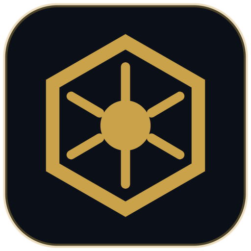

<p align="center"></p>

<h1 align="center">SC Org Tracker</h1>

<p align="center"><b>Star Citizen materials &amp; blueprints — BUILD • TRADE • EXPAND</b></p>

A desktop app for Star Citizen players and orgs: track your materials, gear and blueprints, see what Wikelo
contracts and crafting recipes need, and pool your org's stock by sharing files between members.

## Download

Get the latest version from **[Releases](https://github.com/NLighten-sc/sc-org-tracker/releases/latest)**:

| System | File |
|---|---|
| Windows 10 / 11 | `SC-Org-Tracker-Setup-<version>.exe` |
| Linux | `SC-Org-Tracker-<version>.AppImage` |

Once installed, the app updates itself, and its game data (blueprints, Wikelo contracts, log patterns and so on)
refreshes at startup after each Star Citizen patch.

### Windows: "Windows protected your PC"

The installer isn't code-signed yet, so Windows SmartScreen shows a blue warning the first time. Click
**More info → Run anyway**. You can choose where to install it.

### Linux

Make the AppImage executable and run it:

```sh
chmod +x SC-Org-Tracker-*.AppImage
./SC-Org-Tracker-*.AppImage
```

If you play through Proton or Wine, point the app at your Star Citizen `LIVE` folder in Settings → Log Reader.

## What it does

- **Materials and gear** by station, with quality, owner (you or your org) and where each item is used
- **Blueprints and Wikelo contracts** with have-vs-need for every ingredient
- **Reports**: contract gap reports and a combined org inventory from members' files
- **Org data**: the org leader shares what the org has and which blueprints it's tracking
- **Trade**: commodity prices and route planning (UEX and SC Trade Tools)
- **Game.log reader** (optional): proposes trades, refinery jobs, gear moves and more from your game log

Your data stays on your PC. Sharing between org members is done with JSON files you export and import yourself.

## Safe to use

The app only **reads** `Game.log` from your Star Citizen folder. It never touches game memory, network traffic or
game files, the same as other community log readers.

## Data folder

Your inventory and settings live in `%APPDATA%\sc-org-tracker` (Windows) or `~/.config/sc-org-tracker` (Linux).
Uninstalling or updating leaves them in place.

## Credits and disclaimer

Data from the [Star Citizen Wiki](https://starcitizen.tools/) (CC BY-SA 4.0), [SC Datahub](https://www.sc-datahub.com/),
[sc-craft.tools](https://sc-craft.tools/), [SCMDB](https://scmdb.net/), [UEX](https://uexcorp.space/),
[SC Trade Tools](https://sc-trade.tools/), [Wikelo Trades](https://www.wikelotrades.com/) and
[scminer.rocks](https://scminer.rocks/).

This is an unofficial fan-made tool, not affiliated with or endorsed by Cloud Imperium Games. Star Citizen®,
Roberts Space Industries® and Cloud Imperium® are registered trademarks of Cloud Imperium Rights LLC. Game data
changes between patches, so check in game before big turn-ins.

Problems or ideas? [Open an issue](https://github.com/NLighten-sc/sc-org-tracker/issues).
